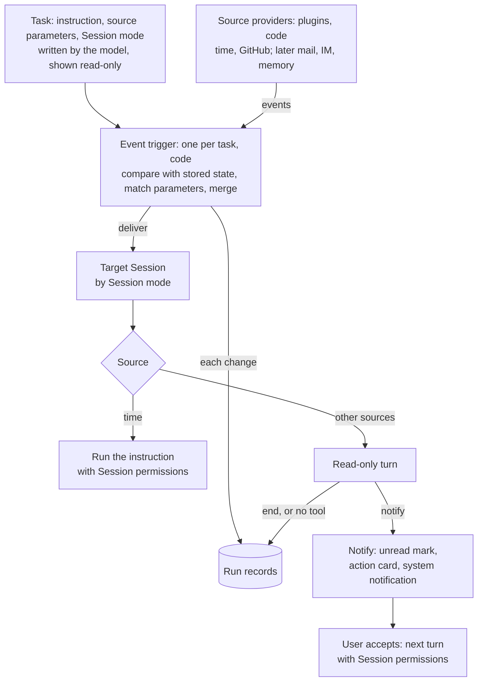

# Agent Note: Event-triggered automation tasks

Status: proposed

English | [中文](2026-10-29-event-triggered-automation-tasks.zh.md)

## Problem

Automation tasks run only on time rules today. The Host stores each rule, and every due time queues the task's instruction as a follow-up message in the task's original Session ([Host-owned scheduled messages](../../implemented/architecture/2026-09-16-host-schedule-storage.md)). Work that should start when something else changes, such as a pull request's checks failing, a reviewer requesting changes, or a message arriving, cannot be expressed as a task, so users check those sources by hand across Sessions.

Reacting to changes brings two problems that time rules do not have.

- **Cost and noise.** Most observations of a source contain nothing worth a model turn. If every observation reaches the model and silence depends on the model replying with a marker, each poll costs a full turn, and a model that holds a messaging tool reports "nothing new" anyway.
- **Untrusted input.** Event content is written by other people: comments, reviews, messages. A turn started by that content must not edit, push, or send anything before the user has seen it.

## Proposal

An automation task becomes an instruction, a source with parameters, and a Session mode. Time is one source among several, so a scheduled task is an automation task whose source is time. Each observation passes three layers, and only the last one calls a model.

| Layer | Decides | Model call | Output |
|---|---|---|---|
| Source provider | What changed in the source | No | Events |
| Event trigger | Whether the change matters to this task | No | A run record; deliver or not |
| Agent | Whether the user needs to act, and what to propose | Only for delivered events | Notify with a card, or end |

### Layers

**Source providers** are code, packaged as plugins. A provider owns one kind of source: it polls or subscribes, reports changes as events with a subject, a one-line summary, detail, and links, and declares the JSON schema of the parameters a task can set. One provider serves every task of its kind. Time is the first provider, and today's schedule rules become its parameters. Any installed plugin can register a provider, including one written in Creator mode; a task can name only a registered provider.

**The event trigger** is code that holds one task's parameters and the source state it last observed. For each observation it compares the new state with the stored one, and an observation without a change only updates the last-checked time. A check that turns from passing to failing is a change, a check that stays failing is not, and a pass followed by a new failure is a change again. For a change, the trigger matches the task's conditions, which are parameter fields such as conclusion is failure, author is the user, or commenter is not a bot; merges changes to the same subject inside the provider's merge window, so one push that fails three checks becomes one event; stores the new state; and decides whether to deliver. Each change and each failure writes a run record: delivered, filtered with its reason, or failed. A delivered record follows the turn to its outcome. One queue per task orders its evaluations.

**The agent** receives a delivered event as a message in the target Session, together with the task's instruction in the user's words. What the turn may do depends on the source.

- **Time**: the turn runs the instruction with the Session's permissions, and its reply is the result, as scheduled tasks behave today.
- **Other sources**: the turn is read-only. It can read files, logs, and pull request state, but cannot edit, push, or send messages, and it ends with one of two new tools. **Notify** takes a title, a summary, and a proposed action: the Session gets its unread mark, an [action card](../../../../packages/experimental/action-cards/README.md) with the proposed action appears in the Session, and the desktop app sends a system notification. **End** takes a reason: the Session gets no unread mark, the turn is collapsed, and the reason stays in the run record. A turn that calls neither tool counts as end. When the user accepts the card, the proposed action is sent as the next message, and that turn runs with the Session's permissions.

### Sessions

A task delivers to its target Session in one of three modes: a specified Session, a new Session per trigger, or a new Session on the first trigger that later triggers reuse. A task created in a conversation defaults to that conversation's Session, where the pull request and its history already are. A task created on the automation page or enabled from a template defaults to a new Session on its first trigger, reused afterwards. The user can change the mode on the task.

No task runs while the Host is stopped. On restart, each task compares the current source state with its stored state once and does not replay intermediate changes. Time keeps today's rule: a recurring task runs its latest missed occurrence once.

### Configuration

Configuration has two layers. Provider code decides what can be observed and how; task parameters decide what one task watches. The model writes the parameters from the user's words through the task tools, and the provider's schema validates them. A task carries no scripts or other code, so observing something new means changing or installing a provider plugin. The automation page shows source parameters read-only, and they change through conversation; the time editor stays.

### Product scope

- No new entry point and no page redesign: scheduled and event-triggered tasks share the automation page.
- The task list adds a source-type filter next to the status filter.
- Task details add the source with its parameters, read-only, and the Session mode, editable.
- A task's Records tab also lists filtered and failed evaluations.
- Notifications reuse the Session unread mark and action cards; the desktop app adds a system notification.

### Event triggers as infrastructure

The trigger layer is shared infrastructure for DSH, not a feature of the automation page. A feature that watches something and hands changes to an agent becomes a task on this layer instead of building its own polling, state, records, and notifications.

- **DSH's own state as sources**: a Session turn ending in an error, a background job settling, and, once memory lands, a memory consolidation pass finishing or memory entries changing.
- **Features on those sources**: plugin recommendations, where a workflow the user repeats by hand shows up after consolidation and the agent proposes a plugin on an action card; task recommendations, where a review of the day's Sessions proposes follow-up work. Each is a template task with a DSH source, an instruction, and the same notify-or-end ending.
- **What every consumer keeps**: change detection and condition matching in code, run records, Session modes, read-only event turns, and notify as the only way a task reaches the user.

### Delivery order

1. Task–Session decoupling with the three Session modes.
2. The trigger layer with time as its first provider; existing scheduled tasks behave as before.
3. The GitHub provider for pull request checks, reviews, and comments; the notify and end tools; read-only event turns.
4. Mail and IM providers, then DSH's own sources.

## Alternatives considered

**Judge every observation in a resident Session.** The model reads each poll and replies with a silence marker when nothing changed. It lost because each observation costs a full turn over the Session's context, polls spaced beyond the prefix cache lifetime read that context uncached, and silence depends on the model following an instruction while it holds a messaging tool. Here code drops unchanged and unmatched observations, and only a notify call reaches the user.

**Condition scripts per task.** A task would carry a script that fetches and decides. It lost because the script runs with the user's credentials without the review a plugin installation gets, and each task would carry its own fetch logic instead of sharing a provider.

**Notify from code when code can decide.** A failed check could notify without a model. It lost because the notification would carry only the raw status. With one path, the agent reads the logs first and the notification states the cause; change-only delivery keeps these turns rare.

**One model call outside any Session.** A single call per event costs less and leaves no Session record. It lost because the call cannot read files or logs before deciding, and acting on its result needs a Session anyway.

**Event turns with the Session's permissions.** Acting directly would save one click. It lost because event content comes from other people, and a read-only turn keeps that text from driving edits, pushes, or messages before the user accepts.

**Parameter forms on the automation page.** Each provider would need its own form, validation, and display. Parameters written by the model and shown read-only cover creation and change through conversation, and the provider schema keeps a generated form possible later.

**A separate notification entry.** An inbox page or tab would separate the notification from the Session that holds its context. The unread mark and the system notification lead to that Session, and the automation page keeps the records.

## Acceptance criteria

- Existing scheduled tasks behave the same after time becomes a provider: the same due times, the same catch-up rule, and the same delivery into the Session.
- A GitHub task on a pull request's checks delivers once when a check turns from passing to failing, not again while it stays failing, and again after a pass followed by a new failure.
- An observation without a change writes no record and starts no turn; a change that fails the conditions writes a filtered record and starts no turn.
- An event turn that ends with end, or with neither tool, gives the Session no unread mark and sends no system notification.
- An event turn cannot edit files, push, or send messages; after the user accepts its card, the next turn runs with the Session's permissions.
- After a restart, a task compares the current source state with its stored state once and does not replay intermediate changes.
- The task list filters by source type, task details show source parameters read-only, and the Session mode can be changed.

## Risks

- Delivering into a long Session reads its whole context once the prefix cache has expired. Change-only delivery keeps this rare, and tasks created outside a conversation use their own Session.
- The agent may notify too often or end too readily. Run records and the accepted and dismissed cards show which instructions need rewriting.
- Source parameters cannot be edited by hand; every change goes through the model.
- A fix on an event waits for the user to accept the card instead of running unattended.
- A source without a provider plugin cannot be watched.
- Tasks run only while the Host runs: nothing runs while the app is closed or the machine sleeps.
